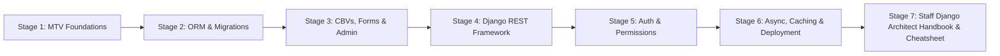
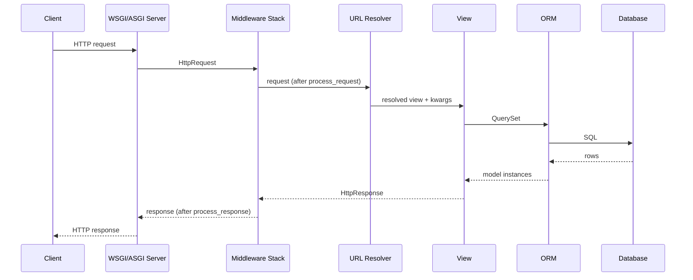
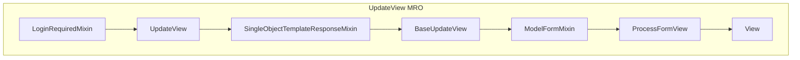
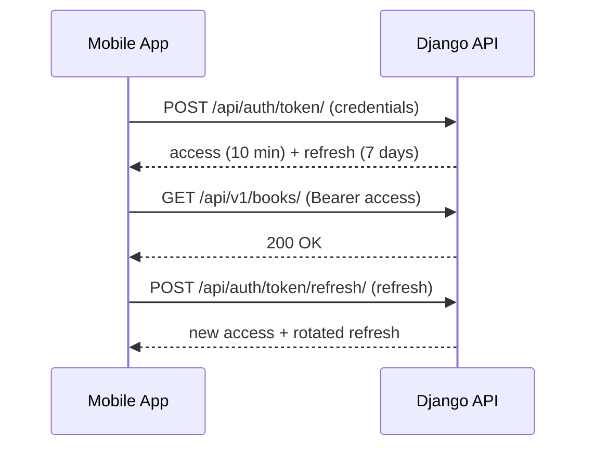
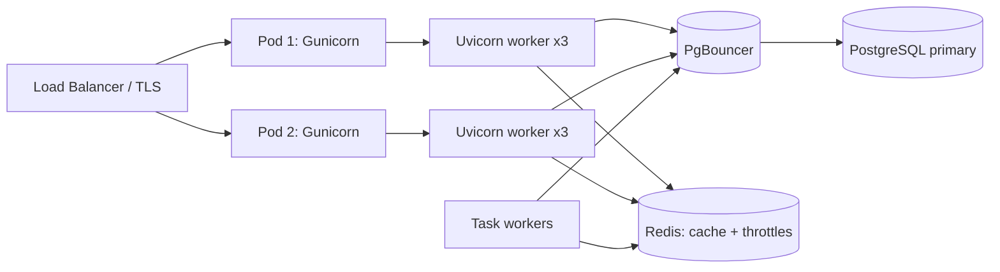

# Learn Django 🐍

<div align="center">

[](https://opensource.org/licenses/MIT)
[](https://www.python.org/)
[](https://www.djangoproject.com/)
[](https://www.django-rest-framework.org/)
[](https://www.postgresql.org/)
[](https://github.com/TheLearningHubOrg/learn-django)

**An exhaustive, production-grade masterclass from absolute zero to staff-level Django and Python web platform architecture.**  
Master the ORM and migrations, class-based views, Django REST Framework, authentication and permissions, async views on ASGI, caching, background tasks, and hardened production deployment.

[Getting Started](#1-stage-1-absolute-beginner-foundations--the-mtv-request-lifecycle) • [ORM & Migrations](#2-stage-2-the-orm-querysets--migrations) • [Class-Based Views](#3-stage-3-class-based-views-forms--the-admin) • [REST Framework](#4-stage-4-django-rest-framework-deep-dive) • [Auth & Security](#5-stage-5-authentication-authorization--security) • [Async & Production](#6-stage-6-async-views-caching--production-deployment) • [Staff Handbook](#7-stage-7-staff-django-architect-interview-handbook--cheatsheet)

<br/>

<a href="https://www.buymeacoffee.com/manthanank">
  
</a>

</div>

---

## 🗺️ 7-Stage Pedagogical Roadmap



| Stage | Domain Focus | Core Concepts & Production Outcomes |
| :--- | :--- | :--- |
| **Stage 1** | **Absolute Beginner Foundations** | Model-Template-View architecture, the request/response lifecycle, `startproject` vs `startapp`, `settings.py` anatomy, `path()` routing, function views, template inheritance. |
| **Stage 2** | **The ORM, QuerySets & Migrations** | Field types, `ForeignKey`/`ManyToManyField`, lazy QuerySets, `F()`/`Q()` expressions, `annotate()`, N+1 elimination with `select_related`/`prefetch_related`, `atomic()`, `select_for_update()`, zero-downtime migrations. |
| **Stage 3** | **Class-Based Views, Forms & Admin** | `View.as_view()` dispatch, generic `ListView`/`UpdateView`, mixin ordering and the MRO, `ModelForm` validation, admin `list_select_related`, custom middleware, signals. |
| **Stage 4** | **Django REST Framework Deep Dive** | `ModelSerializer`, field and object validation, `ModelViewSet`, routers, `@action`, cursor pagination, `django-filter`, throttling, OpenAPI via `drf-spectacular`, pytest-django. |
| **Stage 5** | **Authentication, Authorization & Security** | Custom `AbstractUser`, Argon2 hashing, auth backends, groups and model permissions, object-level DRF permissions, JWT, CSRF, CSP and `SecurityMiddleware`. |
| **Stage 6** | **Async Views, Caching & Production Deployment** | ASGI, `async def` views, async ORM (`aget`, `acount`, `async for`), Redis caching, the `django.tasks` framework, `check --deploy`, multi-stage Docker, Gunicorn + Uvicorn workers, psycopg connection pools. |
| **Stage 7** | **Staff Django Architect Interview Handbook** | Enterprise cheatsheet and 40 staff-level scenarios: query explosions, migration locks, race conditions, async pitfalls, cache stampedes, multi-tenant design. |

---

## 📋 Table of Contents
- [1. Stage 1: Absolute Beginner Foundations & the MTV Request Lifecycle](#1-stage-1-absolute-beginner-foundations--the-mtv-request-lifecycle)
  - [1.1 Why Django & the MTV Architecture](#11-why-django--the-mtv-architecture)
  - [1.2 Installing Django & Bootstrapping a Project](#12-installing-django--bootstrapping-a-project)
  - [1.3 Projects, Apps & Settings Anatomy](#13-projects-apps--settings-anatomy)
  - [1.4 URL Routing, Function Views & Templates](#14-url-routing-function-views--templates)
- [2. Stage 2: The ORM, QuerySets & Migrations](#2-stage-2-the-orm-querysets--migrations)
  - [2.1 Models, Fields & Relationships](#21-models-fields--relationships)
  - [2.2 QuerySet Laziness, Lookups & Expressions](#22-queryset-laziness-lookups--expressions)
  - [2.3 Killing N+1 Queries with `select_related` & `prefetch_related`](#23-killing-n1-queries-with-select_related--prefetch_related)
  - [2.4 Transactions, Locking & Constraints](#24-transactions-locking--constraints)
  - [2.5 Migrations: Schema, Data & Zero-Downtime Changes](#25-migrations-schema-data--zero-downtime-changes)
- [3. Stage 3: Class-Based Views, Forms & the Admin](#3-stage-3-class-based-views-forms--the-admin)
  - [3.1 From Function Views to Class-Based Views](#31-from-function-views-to-class-based-views)
  - [3.2 Generic Views, Mixins & the MRO](#32-generic-views-mixins--the-mro)
  - [3.3 Forms, ModelForms & Validation](#33-forms-modelforms--validation)
  - [3.4 Customising the Admin for Operations Teams](#34-customising-the-admin-for-operations-teams)
  - [3.5 Middleware & Signals](#35-middleware--signals)
- [4. Stage 4: Django REST Framework Deep Dive](#4-stage-4-django-rest-framework-deep-dive)
  - [4.1 Serializers: Validation & Representation](#41-serializers-validation--representation)
  - [4.2 ViewSets, Routers & Custom Actions](#42-viewsets-routers--custom-actions)
  - [4.3 Pagination, Filtering & Throttling](#43-pagination-filtering--throttling)
  - [4.4 API Testing with pytest-django](#44-api-testing-with-pytest-django)
  - [4.5 OpenAPI Schemas & Versioning](#45-openapi-schemas--versioning)
- [5. Stage 5: Authentication, Authorization & Security](#5-stage-5-authentication-authorization--security)
  - [5.1 The Custom User Model (Day One Decision)](#51-the-custom-user-model-day-one-decision)
  - [5.2 Password Hashing & Authentication Backends](#52-password-hashing--authentication-backends)
  - [5.3 Permissions, Groups & Object-Level Access](#53-permissions-groups--object-level-access)
  - [5.4 Token & JWT Authentication for APIs](#54-token--jwt-authentication-for-apis)
  - [5.5 CSRF, CSP & Security Middleware](#55-csrf-csp--security-middleware)
- [6. Stage 6: Async Views, Caching & Production Deployment](#6-stage-6-async-views-caching--production-deployment)
  - [6.1 ASGI, Async Views & the Async ORM](#61-asgi-async-views--the-async-orm)
  - [6.2 Caching Strategies with Redis](#62-caching-strategies-with-redis)
  - [6.3 Background Work: Django Tasks & Celery](#63-background-work-django-tasks--celery)
  - [6.4 Production Settings & `check --deploy`](#64-production-settings--check---deploy)
  - [6.5 Multi-Stage Docker & ASGI Servers](#65-multi-stage-docker--asgi-servers)
  - [6.6 Observability, Logging & Connection Pooling](#66-observability-logging--connection-pooling)
  - [6.7 Running the Companion Project](#67-running-the-companion-project)
- [7. Stage 7: Staff Django Architect Interview Handbook & Cheatsheet](#7-stage-7-staff-django-architect-interview-handbook--cheatsheet)
  - [7.1 Enterprise Production Cheatsheet](#71-enterprise-production-cheatsheet)
  - [7.2 Staff & Principal Architect Interview Q&A (40 Scenarios)](#72-staff--principal-architect-interview-qa-40-scenarios)
- [🤝 Contributing](#-contributing)
- [📄 License](#-license)

---

## 1. Stage 1: Absolute Beginner Foundations & the MTV Request Lifecycle

### 1.1 Why Django & the MTV Architecture

Django is a "batteries included" Python web framework. Out of the box you get an ORM, a migration engine, an admin site, authentication, forms, templating, caching, i18n and a security middleware stack. The trade-off is convention: Django decides where things live so that a team of fifty can navigate a codebase written by a team of five.

Django calls its pattern **MTV** rather than MVC:

1. **Model**: a Python class mapped to a database table. It owns data and business invariants.
2. **Template**: the presentation layer (HTML, or JSON when you use DRF serializers instead).
3. **View**: a callable that takes an `HttpRequest` and returns an `HttpResponse`. It plays the role MVC calls the "controller".

The framework itself, through the URL resolver, acts as the dispatcher. Every request follows the same path:



Middleware wraps the view like an onion. Anything registered higher in `MIDDLEWARE` sees the request first and the response last.

### 1.2 Installing Django & Bootstrapping a Project

Current Django releases require Python 3.12 or newer. Always work inside a virtual environment so each project pins its own dependency set.

```bash
# 1. Create and activate an isolated environment
python -m venv .venv
source .venv/bin/activate        # Windows: .venv\Scripts\activate

# 2. Install Django and the REST toolkit
python -m pip install --upgrade pip
pip install "Django>=5.2,<7" djangorestframework

# 3. Create a project whose settings package is called "config"
django-admin startproject config .

# 4. Create the first app
python manage.py startapp catalog

# 5. Apply the built-in migrations and start the dev server
python manage.py migrate
python manage.py createsuperuser
python manage.py runserver 8000
```

Naming the settings package `config` (instead of repeating the project name) keeps imports readable: `config.settings`, `config.urls`, `config.asgi`.

### 1.3 Projects, Apps & Settings Anatomy

A **project** is the deployable unit: settings, root URLconf and the WSGI/ASGI entry points. An **app** is a reusable bounded context with its own models, views, migrations and tests. A healthy codebase has several small apps, not one giant one.

```
learn-django/
├── manage.py                 # CLI entry point
├── src/
│   ├── config/               # the project
│   │   ├── settings.py
│   │   ├── urls.py
│   │   ├── asgi.py
│   │   └── wsgi.py
│   └── catalog/              # an app (bounded context)
│       ├── models.py
│       ├── serializers.py
│       ├── views.py
│       ├── urls.py
│       ├── admin.py
│       └── migrations/
└── tests/
```

The settings you will touch on day one:

| Setting | Purpose |
| :--- | :--- |
| `INSTALLED_APPS` | Apps whose models, templates, admin and management commands Django loads. Order matters for template and static file overrides. |
| `MIDDLEWARE` | The request/response pipeline, top to bottom on the way in. |
| `DATABASES` | Connection settings per alias (`default`, `replica`, ...). |
| `ROOT_URLCONF` | Dotted path to the root URL module. |
| `DEFAULT_AUTO_FIELD` | Primary key type for models that do not declare one. Use `BigAutoField`. |
| `SECRET_KEY` | Signs sessions, password reset tokens and CSRF tokens. Never commit it. |

Read every secret from the environment. The companion project does this with a tiny helper:

```python
# src/config/settings.py (excerpt)
import os

def env_bool(name: str, default: bool = False) -> bool:
    return os.environ.get(name, str(default)).strip().lower() in {"1", "true", "yes", "on"}

DEBUG = env_bool("DJANGO_DEBUG", default=True)
SECRET_KEY = os.environ.get("DJANGO_SECRET_KEY", "dev-only-insecure-key-change-me")
ALLOWED_HOSTS = [h for h in os.environ.get("DJANGO_ALLOWED_HOSTS", "localhost").split(",") if h]
```

### 1.4 URL Routing, Function Views & Templates

`path()` maps a URL pattern to a view, with typed converters (`int`, `slug`, `uuid`, `path`, `str`). `include()` delegates a prefix to an app's own URLconf, and `app_name` namespaces the route names so `reverse("catalog:detail", ...)` never collides with another app.

```python
# catalog/urls.py
from django.urls import path
from . import views

app_name = "catalog"

urlpatterns = [
    path("", views.book_list, name="list"),
    path("<int:pk>/", views.book_detail, name="detail"),
]
```

```python
# catalog/views.py
from django.shortcuts import get_object_or_404, render
from .models import Book

def book_list(request):
    books = Book.objects.select_related("owner").order_by("title")[:50]
    return render(request, "catalog/book_list.html", {"books": books})

def book_detail(request, pk: int):
    book = get_object_or_404(Book, pk=pk)
    return render(request, "catalog/book_detail.html", {"book": book})
```

Templates use inheritance: a base layout defines `` slots and child templates fill them. Output is auto-escaped, which is your first line of defence against XSS.

```html
<!-- templates/catalog/book_list.html -->

Catalog

  <ul>
    
      <li><a href="">{{ book.title }}</a> by {{ book.author }}</li>
    
      <li>No books yet.</li>
    
  </ul>

```

---

## 2. Stage 2: The ORM, QuerySets & Migrations

### 2.1 Models, Fields & Relationships

Each model class becomes a table and each field becomes a column. Relationships are first class:

1. **`ForeignKey`**: many-to-one. Always choose `on_delete` deliberately (`CASCADE`, `PROTECT`, `SET_NULL`, `RESTRICT`).
2. **`OneToOneField`**: a unique foreign key, often used for profile tables.
3. **`ManyToManyField`**: a hidden join table, or an explicit one via `through=` when the link carries data.

```python
# catalog/models.py
from django.conf import settings
from django.db import models
from django.db.models.functions import Lower


class Publisher(models.Model):
    name = models.CharField(max_length=120, unique=True)


class Tag(models.Model):
    slug = models.SlugField(unique=True)


class Book(models.Model):
    class Status(models.TextChoices):
        DRAFT = "draft", "Draft"
        PUBLISHED = "published", "Published"

    title = models.CharField(max_length=200)
    isbn = models.CharField(max_length=13, unique=True)
    status = models.CharField(max_length=10, choices=Status, default=Status.DRAFT)
    price_cents = models.PositiveIntegerField(db_default=0)
    publisher = models.ForeignKey(Publisher, on_delete=models.PROTECT, related_name="books")
    owner = models.ForeignKey(settings.AUTH_USER_MODEL, on_delete=models.CASCADE)
    tags = models.ManyToManyField(Tag, blank=True, related_name="books")
    created_at = models.DateTimeField(auto_now_add=True)

    class Meta:
        ordering = ["-created_at"]
        indexes = [models.Index(Lower("title"), name="book_title_lower_idx")]

    def __str__(self) -> str:
        return self.title
```

`db_default` (added in Django 5.0) makes the database, not Python, supply the default, so rows inserted by other services get it too. `GeneratedField` goes a step further and lets the database compute a column from other columns.

### 2.2 QuerySet Laziness, Lookups & Expressions

A `QuerySet` is a description of a query, not its result. Nothing touches the database until you iterate, slice with a step, call `len()`, `list()`, `bool()`, or a terminal method such as `get()`, `count()` or `exists()`. This lets you chain filters cheaply and lets Django build a single SQL statement.

```python
from django.db.models import Avg, Count, F, Q, Value
from django.db.models.functions import Coalesce

# 1. Lookups use double underscores across relations
Book.objects.filter(publisher__name__iexact="o'reilly", created_at__year=2026)

# 2. Q objects express OR / NOT
Book.objects.filter(Q(status="published") | Q(owner=request.user), ~Q(price_cents=0))

# 3. F expressions push arithmetic into SQL and avoid read-modify-write races
Book.objects.filter(pk=book_id).update(price_cents=F("price_cents") + 100)

# 4. Aggregation per row with annotate(), across the set with aggregate()
publishers = Publisher.objects.annotate(
    book_count=Count("books"),
    avg_price=Coalesce(Avg("books__price_cents"), Value(0.0)),
).filter(book_count__gt=10)

# 5. Only fetch what you need
Book.objects.values_list("id", "title", named=True)
Book.objects.only("id", "title")   # deferred model instances

# 6. Stream huge result sets without caching them in memory
for book in Book.objects.order_by("pk").iterator(chunk_size=2000):
    ...
```

A QuerySet caches its results after the first evaluation. Re-using the same object avoids a second query; calling `.all()` again creates a fresh one.

### 2.3 Killing N+1 Queries with `select_related` & `prefetch_related`

The N+1 problem is the most common Django performance bug. A loop that touches a related object issues one extra query per row.

```
BEFORE (N+1)                                  AFTER
-------------------------------------         -------------------------------------
SELECT * FROM book LIMIT 50;      -- 1        SELECT book.*, publisher.*
SELECT * FROM publisher WHERE id=1; -- 2        FROM book JOIN publisher ...;  -- 1
SELECT * FROM publisher WHERE id=2; -- 3      SELECT * FROM tag JOIN book_tags
...                                             WHERE book_id IN (...);        -- 2
SELECT * FROM publisher WHERE id=9; -- 51
```

1. **`select_related`** follows `ForeignKey` and `OneToOneField` with a SQL `JOIN`. One query, wider rows.
2. **`prefetch_related`** handles reverse foreign keys and many-to-many with a second `IN (...)` query, then stitches results together in Python.
3. **`Prefetch`** objects let you filter or order the prefetched set and store it on a custom attribute.

```python
from django.db.models import Prefetch

books = (
    Book.objects
    .select_related("publisher", "owner")
    .prefetch_related(
        Prefetch("tags", queryset=Tag.objects.order_by("slug"), to_attr="sorted_tags")
    )
)

# Guard against regressions in tests
def test_book_list_query_budget(client, django_assert_max_num_queries):
    with django_assert_max_num_queries(4):
        client.get("/api/v1/books/")
```

Put a query budget assertion on every list endpoint. It turns a silent production slowdown into a failing test.

### 2.4 Transactions, Locking & Constraints

By default Django runs in autocommit mode: each query commits on its own. Wrap multi-step writes in `transaction.atomic()` so they succeed or fail together. Setting `ATOMIC_REQUESTS = True` on a database wraps every request, which is simple but holds transactions open for the full view.

```python
from django.db import transaction
from django.db.models import F

class InsufficientStock(Exception):
    pass

def reserve_copy(book_id: int, user) -> "Reservation":
    with transaction.atomic():
        # 1. Row lock: concurrent callers queue here instead of overselling
        inventory = Inventory.objects.select_for_update().get(book_id=book_id)
        if inventory.available < 1:
            raise InsufficientStock(book_id)

        # 2. Arithmetic in SQL, not Python
        Inventory.objects.filter(pk=inventory.pk).update(available=F("available") - 1)
        reservation = Reservation.objects.create(book_id=book_id, user=user)

        # 3. Side effects only after a successful commit
        transaction.on_commit(lambda: notify_reserved.enqueue(reservation_id=reservation.pk))
        return reservation
```

Database constraints are the last line of defence when application validation is bypassed by a race, a script or another service:

```python
class Meta:
    constraints = [
        models.CheckConstraint(condition=models.Q(price_cents__gte=0), name="book_price_non_negative"),
        models.UniqueConstraint(
            fields=["owner", "title"],
            condition=models.Q(status="draft"),
            name="unique_draft_title_per_owner",
        ),
    ]
```

### 2.5 Migrations: Schema, Data & Zero-Downtime Changes

Migrations are versioned Python files describing schema changes. `makemigrations` diffs your models against the migration history; `migrate` applies the result. Commit migrations with the code that needs them and never edit one that has already run in production.

```bash
python manage.py makemigrations catalog       # generate
python manage.py sqlmigrate catalog 0002      # review the exact SQL
python manage.py migrate                      # apply
python manage.py showmigrations               # status
python manage.py makemigrations --check       # CI guard: fail if models drift
```

Data migrations use `RunPython`. Always use the historical model from `apps.get_model()`, never a direct import, because the real model may have changed since the migration was written.

```python
# catalog/migrations/0003_backfill_slug.py
from django.db import migrations
from django.utils.text import slugify


def backfill_slugs(apps, schema_editor):
    Book = apps.get_model("catalog", "Book")
    for book in Book.objects.filter(slug="").iterator(chunk_size=1000):
        book.slug = slugify(book.title)[:50]
        book.save(update_fields=["slug"])


class Migration(migrations.Migration):
    dependencies = [("catalog", "0002_book_slug")]
    operations = [migrations.RunPython(backfill_slugs, migrations.RunPython.noop)]
```

During a rolling deploy, old and new code run against the same schema at once. Use the **expand / migrate / contract** pattern:


On PostgreSQL, build indexes on large tables with `AddIndexConcurrently` from `django.contrib.postgres.operations` and mark the migration `atomic = False`, since `CREATE INDEX CONCURRENTLY` cannot run inside a transaction.

---

## 3. Stage 3: Class-Based Views, Forms & the Admin

### 3.1 From Function Views to Class-Based Views

A class-based view (CBV) turns HTTP methods into methods on a class. `as_view()` returns a function that instantiates the class per request and calls `dispatch()`, which routes to `get()`, `post()` and so on.

```python
from django.http import JsonResponse
from django.views import View


class PingView(View):
    http_method_names = ["get", "head", "options"]

    def get(self, request, *args, **kwargs):
        return JsonResponse({"pong": True})

# urls.py: path("ping/", PingView.as_view())
```

Because a new instance is created for each request, storing request state on `self` is safe. Class attributes, on the other hand, are shared across every request in the process.

### 3.2 Generic Views, Mixins & the MRO

Generic views (`ListView`, `DetailView`, `CreateView`, `UpdateView`, `DeleteView`) implement the common CRUD flows. Their behaviour comes from small mixins combined through Python's method resolution order (MRO), so overriding a hook such as `get_queryset()` or `form_valid()` is all you usually need.



```python
from django.contrib.auth.mixins import LoginRequiredMixin, PermissionRequiredMixin
from django.urls import reverse_lazy
from django.views.generic import ListView, UpdateView


class BookListView(ListView):
    model = Book
    paginate_by = 25
    template_name = "catalog/book_list.html"

    def get_queryset(self):
        return super().get_queryset().select_related("publisher").filter(status="published")


class BookUpdateView(LoginRequiredMixin, PermissionRequiredMixin, UpdateView):
    model = Book
    fields = ["title", "price_cents", "tags"]
    permission_required = "catalog.change_book"
    success_url = reverse_lazy("catalog:list")

    def get_queryset(self):
        # Object-level scoping: users can only reach their own rows
        return super().get_queryset().filter(owner=self.request.user)
```

Access mixins must sit to the **left** of the view class. Placed on the right, `dispatch()` on the view runs first and the check never happens.

### 3.3 Forms, ModelForms & Validation

Forms convert untrusted input into clean Python values. Validation runs in a fixed order: each field's `to_python()` and validators, then `clean_<field>()`, then `clean()` for cross-field rules.

```python
from django import forms
from django.core.exceptions import ValidationError


class BookForm(forms.ModelForm):
    class Meta:
        model = Book
        fields = ["title", "isbn", "status", "price_cents"]

    def clean_isbn(self):
        isbn = self.cleaned_data["isbn"].replace("-", "")
        if not isbn.isdigit() or len(isbn) not in (10, 13):
            raise ValidationError("Enter a 10 or 13 digit ISBN.")
        return isbn

    def clean(self):
        cleaned = super().clean()
        if cleaned.get("status") == Book.Status.PUBLISHED and not cleaned.get("price_cents"):
            self.add_error("price_cents", "Published books need a price.")
        return cleaned
```

`ModelForm` also calls `Model.full_clean()` validation for the fields it includes, so model-level validators and unique checks surface as form errors instead of database exceptions.

### 3.4 Customising the Admin for Operations Teams

The admin is a production tool for support staff, not just a developer toy. The three settings that matter most at scale are `list_select_related` (stops N+1 on the changelist), `raw_id_fields` or `autocomplete_fields` (stops loading a 2-million row dropdown) and `show_full_result_count = False` (skips an expensive `COUNT(*)`).

```python
from django.contrib import admin


@admin.register(Book)
class BookAdmin(admin.ModelAdmin):
    list_display = ("title", "publisher", "status", "price_cents", "created_at")
    list_filter = ("status", "publisher")
    search_fields = ("title", "isbn")
    list_select_related = ("publisher",)
    autocomplete_fields = ("publisher",)
    show_full_result_count = False
    actions = ["publish"]

    @admin.action(description="Mark selected books as published")
    def publish(self, request, queryset):
        updated = queryset.update(status=Book.Status.PUBLISHED)
        self.message_user(request, f"{updated} books published.")
```

Move the admin off `/admin/` in production, put it behind SSO or a VPN, and require staff accounts to use strong authentication.

### 3.5 Middleware & Signals

Middleware is a callable factory. It receives `get_response` once at startup and returns a callable that runs per request. Code before `get_response(request)` runs on the way in; code after runs on the way out.

```python
# config/middleware.py
import time
import uuid
import logging

logger = logging.getLogger("request")


class RequestIdMiddleware:
    def __init__(self, get_response):
        self.get_response = get_response

    def __call__(self, request):
        request.request_id = request.headers.get("X-Request-ID", uuid.uuid4().hex)
        started = time.perf_counter()
        response = self.get_response(request)
        elapsed_ms = (time.perf_counter() - started) * 1000
        response["X-Request-ID"] = request.request_id
        logger.info("%s %s %s %.1fms", request.method, request.path, response.status_code, elapsed_ms)
        return response
```

**Signals** (`post_save`, `pre_delete`, `m2m_changed`) decouple senders from receivers, but they hide control flow and do not fire on `QuerySet.update()` or `bulk_create()`. Prefer explicit service functions for business logic, and keep signals for cross-cutting concerns such as cache invalidation or audit logs.

---

## 4. Stage 4: Django REST Framework Deep Dive

### 4.1 Serializers: Validation & Representation

A serializer does two jobs: it turns model instances into primitive data (`to_representation`) and it validates incoming data into Python values (`to_internal_value`). `ModelSerializer` generates fields and validators from the model, including `UniqueValidator` for unique columns.

```python
from rest_framework import serializers
from rest_framework.validators import UniqueValidator


class ISBNField(serializers.CharField):
    """Normalise before validators run, so length and uniqueness see the stored form."""

    def to_internal_value(self, data):
        return super().to_internal_value(data).replace("-", "")


class BookSerializer(serializers.ModelSerializer):
    owner = serializers.ReadOnlyField(source="owner.username")
    isbn = ISBNField(max_length=13, validators=[UniqueValidator(queryset=Book.objects.all())])

    class Meta:
        model = Book
        fields = ["id", "title", "author", "isbn", "published", "owner", "created_at"]
        read_only_fields = ["id", "owner", "created_at"]

    def validate_isbn(self, value: str) -> str:
        if len(value) not in (10, 13) or not value[:-1].isdigit():
            raise serializers.ValidationError("ISBN must have 10 or 13 digits.")
        return value
```

The custom field matters. If you normalised the ISBN inside `validate_isbn()` instead, the model's `max_length` and uniqueness validators would already have run on the raw, hyphenated string: `978-0441013593` would fail the length check, and a duplicate typed with hyphens would slip past `UniqueValidator` and hit an `IntegrityError` at the database.

Validation order inside DRF:

1. Field `to_internal_value()`, then the field's `validators`.
2. `validate_<field>()` methods.
3. `validate(self, attrs)` for cross-field rules, then serializer-level `Meta.validators`.

### 4.2 ViewSets, Routers & Custom Actions

A `ModelViewSet` bundles `list`, `create`, `retrieve`, `update`, `partial_update` and `destroy`. A router generates the URLs. Override `get_queryset()` for scoping and `perform_create()` to inject server-side values that clients must never control.

```python
from django.db.models import Count
from rest_framework import permissions, status, viewsets
from rest_framework.decorators import action
from rest_framework.response import Response
from rest_framework.routers import DefaultRouter


class BookViewSet(viewsets.ModelViewSet):
    serializer_class = BookSerializer
    permission_classes = [permissions.IsAuthenticatedOrReadOnly, IsOwnerOrReadOnly]

    def get_queryset(self):
        qs = Book.objects.select_related("owner")
        if author := self.request.query_params.get("author"):
            qs = qs.filter(author__icontains=author)
        return qs

    def perform_create(self, serializer):
        serializer.save(owner=self.request.user)

    @action(detail=False, methods=["get"])
    def stats(self, request):
        data = Book.objects.values("author").annotate(total=Count("id")).order_by("-total")[:10]
        return Response(list(data), status=status.HTTP_200_OK)


router = DefaultRouter()
router.register("books", BookViewSet, basename="book")
urlpatterns = router.urls   # /books/, /books/{pk}/, /books/stats/
```

### 4.3 Pagination, Filtering & Throttling

Configure sane global defaults in `REST_FRAMEWORK` and override per view only when needed.

```python
# config/settings.py
REST_FRAMEWORK = {
    "DEFAULT_AUTHENTICATION_CLASSES": [
        "rest_framework_simplejwt.authentication.JWTAuthentication",
        "rest_framework.authentication.SessionAuthentication",
    ],
    "DEFAULT_PERMISSION_CLASSES": ["rest_framework.permissions.IsAuthenticated"],
    "DEFAULT_PAGINATION_CLASS": "rest_framework.pagination.PageNumberPagination",
    "PAGE_SIZE": 20,
    "DEFAULT_FILTER_BACKENDS": [
        "django_filters.rest_framework.DjangoFilterBackend",
        "rest_framework.filters.OrderingFilter",
        "rest_framework.filters.SearchFilter",
    ],
    "DEFAULT_THROTTLE_CLASSES": [
        "rest_framework.throttling.AnonRateThrottle",
        "rest_framework.throttling.UserRateThrottle",
    ],
    "DEFAULT_THROTTLE_RATES": {"anon": "60/minute", "user": "600/minute"},
    "DEFAULT_SCHEMA_CLASS": "drf_spectacular.openapi.AutoSchema",
}
```

Page-number pagination runs `COUNT(*)` and `OFFSET`, both of which get slower as tables grow. For feeds and very large tables, switch to cursor pagination, which seeks on an indexed column:

```python
from rest_framework.pagination import CursorPagination


class CreatedCursorPagination(CursorPagination):
    page_size = 50
    ordering = "-created_at"   # must be unique-ish and indexed


class EventViewSet(viewsets.ReadOnlyModelViewSet):
    pagination_class = CreatedCursorPagination
    filterset_fields = ["kind", "actor"]
    ordering_fields = ["created_at"]
    search_fields = ["message"]
```

Throttle state lives in the cache. With the default local-memory cache each process counts separately, so a limit of 600/minute across 12 processes is effectively $600 \times 12 = 7200$/minute. Use a shared Redis cache in production.

### 4.4 API Testing with pytest-django

`pytest-django` provides the `db` mark, `client`, `admin_client`, `settings` and `django_assert_num_queries` fixtures. DRF's `APIClient.force_authenticate()` skips the authentication layer so tests focus on permissions and behaviour.

```python
# tests/test_api.py (excerpt from the companion project)
import pytest
from django.contrib.auth import get_user_model
from rest_framework.test import APIClient

from catalog.models import Book

pytestmark = pytest.mark.django_db
BOOKS_URL = "/api/v1/books/"


@pytest.fixture
def api_client():
    return APIClient()


@pytest.fixture
def alice():
    return get_user_model().objects.create_user(username="alice")


def test_authenticated_create_sets_owner_and_cleans_isbn(api_client, alice):
    api_client.force_authenticate(user=alice)
    payload = {"title": "Dune", "author": "Frank Herbert", "isbn": "978-0441013593"}
    response = api_client.post(BOOKS_URL, payload, format="json")
    assert response.status_code == 201
    book = Book.objects.get()
    assert book.owner == alice
    assert book.isbn == "9780441013593"
```

```toml
# pyproject.toml
[tool.pytest.ini_options]
DJANGO_SETTINGS_MODULE = "config.settings"
pythonpath = ["src"]
testpaths = ["tests"]
```

Speed tips: run with `--reuse-db` locally, use `pytest-xdist` (`-n auto`) in CI, and set a fast hasher such as `MD5PasswordHasher` in test settings so `create_user(password=...)` does not burn CPU.

### 4.5 OpenAPI Schemas & Versioning

`drf-spectacular` introspects serializers and viewsets to produce an OpenAPI 3 document. Generate it in CI and diff it to catch accidental breaking changes.

```python
# config/urls.py
from django.urls import include, path
from drf_spectacular.views import SpectacularAPIView, SpectacularSwaggerView

urlpatterns = [
    path("api/v1/", include("catalog.urls")),
    path("api/schema/", SpectacularAPIView.as_view(), name="schema"),
    path("api/docs/", SpectacularSwaggerView.as_view(url_name="schema"), name="docs"),
]
```

```bash
python manage.py spectacular --file openapi.yaml --validate
```

Version in the URL (`/api/v1/`) for public APIs because it is visible, cacheable and easy to route at the load balancer. DRF also supports `AcceptHeaderVersioning` and `NamespaceVersioning`; whichever you pick, read `request.version` in `get_serializer_class()` rather than forking whole viewsets.

---

## 5. Stage 5: Authentication, Authorization & Security

### 5.1 The Custom User Model (Day One Decision)

Swapping the user model after the first migration is painful because every foreign key to `auth.User` must be rewritten. Start every project with a custom model, even if it adds nothing yet.

```python
# accounts/models.py
from django.contrib.auth.models import AbstractUser
from django.db import models


class User(AbstractUser):
    email = models.EmailField(unique=True)
    display_name = models.CharField(max_length=80, blank=True)

    REQUIRED_FIELDS = ["email"]
```

```python
# config/settings.py
AUTH_USER_MODEL = "accounts.User"
```

Elsewhere, always reference `settings.AUTH_USER_MODEL` in model fields and `get_user_model()` in runtime code. Never import `User` directly.

### 5.2 Password Hashing & Authentication Backends

Django stores passwords as `algorithm$params$salt$hash` and transparently upgrades old hashes on the next successful login. Put Argon2 first (install with `pip install "django[argon2]"`) and keep PBKDF2 in the list so existing hashes still verify.

```python
PASSWORD_HASHERS = [
    "django.contrib.auth.hashers.Argon2PasswordHasher",
    "django.contrib.auth.hashers.PBKDF2PasswordHasher",
    "django.contrib.auth.hashers.ScryptPasswordHasher",
]

AUTH_PASSWORD_VALIDATORS = [
    {"NAME": "django.contrib.auth.password_validation.UserAttributeSimilarityValidator"},
    {"NAME": "django.contrib.auth.password_validation.MinimumLengthValidator", "OPTIONS": {"min_length": 12}},
    {"NAME": "django.contrib.auth.password_validation.CommonPasswordValidator"},
]

AUTHENTICATION_BACKENDS = [
    "accounts.backends.EmailBackend",
    "django.contrib.auth.backends.ModelBackend",
]
```

`authenticate()` tries each backend in order until one returns a user. A custom backend lets users sign in with an email address:

```python
# accounts/backends.py
from django.contrib.auth import get_user_model
from django.contrib.auth.backends import ModelBackend


class EmailBackend(ModelBackend):
    def authenticate(self, request, username=None, password=None, **kwargs):
        User = get_user_model()
        try:
            user = User.objects.get(email__iexact=username)
        except User.DoesNotExist:
            User().set_password(password)   # equalise timing to resist user enumeration
            return None
        if user.check_password(password) and self.user_can_authenticate(user):
            return user
        return None
```

### 5.3 Permissions, Groups & Object-Level Access

For every model Django creates `add_`, `change_`, `delete_` and `view_` permissions. Assign them to **groups** that mirror job roles, then assign users to groups. Check them with `user.has_perm("catalog.change_book")`.

Model permissions answer "can this person edit books?". Object permissions answer "can this person edit *this* book?". DRF splits the two into `has_permission()` (runs for every request) and `has_object_permission()` (runs when the view calls `get_object()`).

```python
# catalog/permissions.py
from rest_framework import permissions


class IsOwnerOrReadOnly(permissions.BasePermission):
    """Anyone may read; only the owner may change or delete an object."""

    def has_object_permission(self, request, view, obj) -> bool:
        if request.method in permissions.SAFE_METHODS:
            return True
        return obj.owner_id == request.user.id
```

Object permissions are **not** applied to list endpoints, since DRF does not call `has_object_permission()` for each row. Scope list queries in `get_queryset()`, otherwise users can still enumerate data they should not see.

### 5.4 Token & JWT Authentication for APIs

Session authentication is ideal for browser clients on the same site. For mobile apps and service-to-service calls, use short-lived JWT access tokens with longer-lived refresh tokens via `djangorestframework-simplejwt`.

```python
# config/settings.py
from datetime import timedelta

SIMPLE_JWT = {
    "ACCESS_TOKEN_LIFETIME": timedelta(minutes=10),
    "REFRESH_TOKEN_LIFETIME": timedelta(days=7),
    "ROTATE_REFRESH_TOKENS": True,
    "BLACKLIST_AFTER_ROTATION": True,   # needs rest_framework_simplejwt.token_blacklist in INSTALLED_APPS
    "AUTH_HEADER_TYPES": ("Bearer",),
}
```

```python
# config/urls.py
from rest_framework_simplejwt.views import TokenObtainPairView, TokenRefreshView

urlpatterns += [
    path("api/auth/token/", TokenObtainPairView.as_view(), name="token_obtain"),
    path("api/auth/token/refresh/", TokenRefreshView.as_view(), name="token_refresh"),
]
```



JWTs cannot be revoked before expiry without server state, which is why the access lifetime stays short and refresh tokens are blacklisted on rotation.

### 5.5 CSRF, CSP & Security Middleware

1. **CSRF**: `CsrfViewMiddleware` rejects unsafe requests that lack a token matching the CSRF cookie. DRF enforces it for `SessionAuthentication` but not for token or JWT auth, because those headers cannot be sent cross-site by a browser automatically.
2. **CSP**: Django 6.0 added built-in Content Security Policy support through `ContentSecurityPolicyMiddleware` and the `SECURE_CSP` setting, including per-request nonces for inline scripts.
3. **`SecurityMiddleware`**: HSTS, SSL redirect, `X-Content-Type-Options` and referrer policy.
4. **Clickjacking**: `XFrameOptionsMiddleware` sends `X-Frame-Options: DENY` by default.

```python
from django.utils.csp import CSP

MIDDLEWARE = [
    "django.middleware.security.SecurityMiddleware",
    "django.middleware.csp.ContentSecurityPolicyMiddleware",
    # ... session, common, csrf, auth, messages, clickjacking
]

SECURE_CSP = {
    "default-src": [CSP.SELF],
    "script-src": [CSP.SELF, CSP.NONCE],
    "img-src": [CSP.SELF, "data:"],
    "frame-ancestors": [CSP.NONE],
}
```

Roll out a new policy with `SECURE_CSP_REPORT_ONLY` first, watch the violation reports, then enforce it.

---

## 6. Stage 6: Async Views, Caching & Production Deployment

### 6.1 ASGI, Async Views & the Async ORM

Under an ASGI server (Uvicorn, Daphne, Granian), Django can run `async def` views natively. Async helps when a view spends most of its time waiting on the network: calling other HTTP services, fan-out requests, long polling or streaming responses. It does not make CPU-bound code or a single SQL query faster.

```python
import asyncio
import httpx
from django.http import JsonResponse


async def book_dashboard(request, pk: int):
    # 1. Async ORM methods are prefixed with "a"
    book = await Book.objects.select_related("publisher").aget(pk=pk)
    review_count = await Review.objects.filter(book=book).acount()

    # 2. Fan out to slow external services concurrently
    async with httpx.AsyncClient(timeout=3.0) as client:
        pricing, stock = await asyncio.gather(
            client.get(f"https://pricing.internal/books/{book.isbn}"),
            client.get(f"https://stock.internal/books/{book.isbn}"),
        )

    # 3. Async iteration over a QuerySet
    tags = [tag.slug async for tag in book.tags.all()]

    return JsonResponse({
        "title": book.title,
        "publisher": book.publisher.name,
        "reviews": review_count,
        "price": pricing.json(),
        "stock": stock.json(),
        "tags": tags,
    })
```

Rules of thumb:

1. **Never call blocking code** (sync ORM, `requests`, `time.sleep`) from an async view. Wrap unavoidable sync code with `asgiref.sync.sync_to_async`.
2. **Transactions are sync-only**. Put `transaction.atomic()` blocks in a sync function and call it through `sync_to_async`.
3. **Middleware mismatch costs**: every sync-only middleware in an async stack forces a thread hop per request. Keep the stack fully async-capable if you go async.
4. **Under WSGI**, async views still work, but Django runs each one in its own event loop, so you pay the overhead without the concurrency gain.

### 6.2 Caching Strategies with Redis

Django ships a native Redis backend. Cache at the right layer: whole responses for anonymous pages, fragments in templates, and computed values in code.

```python
CACHES = {
    "default": {
        "BACKEND": "django.core.cache.backends.redis.RedisCache",
        "LOCATION": os.environ.get("REDIS_URL", "redis://localhost:6379/1"),
        "TIMEOUT": 300,
        "KEY_PREFIX": "learn-django",
    }
}
```

```python
from django.core.cache import cache
from django.db.models.signals import post_save
from django.dispatch import receiver
from django.views.decorators.cache import cache_page

# 1. Whole-view cache for 60 seconds
@cache_page(60)
def public_catalog(request): ...

# 2. Read-through cache for an expensive computation
def top_authors() -> list[dict]:
    return cache.get_or_set("stats:top-authors", _compute_top_authors, timeout=600)

# 3. Explicit invalidation on write
@receiver(post_save, sender=Book)
def bust_author_cache(sender, instance, **kwargs):
    cache.delete("stats:top-authors")
```

Watch for the **cache stampede**: when a hot key expires, hundreds of requests recompute it at once. Mitigate with a short lock (`cache.add("lock:key", 1, 10)` succeeds for only one caller), jittered TTLs, or serving stale data while one worker refreshes.

### 6.3 Background Work: Django Tasks & Celery

Anything slower than a few hundred milliseconds (emails, PDF rendering, webhooks, imports) belongs outside the request. Django 6.0 introduced a built-in **tasks framework** (`django.tasks`) that standardises how you define and enqueue work. Django ships development backends; the worker that actually executes tasks in production comes from a third-party backend.

```python
# catalog/tasks.py
from django.core.mail import send_mail
from django.tasks import task


@task
def send_welcome_email(user_id: int) -> None:
    user = get_user_model().objects.get(pk=user_id)
    send_mail("Welcome", f"Hi {user.username}!", None, [user.email])
```

```python
# Enqueue after the transaction commits so the worker can see the row
transaction.on_commit(lambda: send_welcome_email.enqueue(user_id=user.pk))

# settings.py: run tasks inline in development and tests
TASKS = {"default": {"BACKEND": "django.tasks.backends.immediate.ImmediateBackend"}}
```

Task arguments must be JSON-serialisable, so pass primary keys, not model instances. For complex pipelines (chords, chains, rate-limited queues, periodic schedules) **Celery** with Redis or RabbitMQ remains the mature choice. Whatever runner you choose, make tasks **idempotent**: brokers deliver at least once, so a task can run twice.

### 6.4 Production Settings & `check --deploy`

```bash
DJANGO_DEBUG=false DJANGO_SECRET_KEY=x python manage.py check --deploy
```

`check --deploy` flags missing HSTS, insecure cookies, `DEBUG=True` and more. The companion project switches hardening on whenever debug is off:

```python
if not DEBUG:
    SECURE_PROXY_SSL_HEADER = ("HTTP_X_FORWARDED_PROTO", "https")
    SECURE_SSL_REDIRECT = env_bool("DJANGO_SSL_REDIRECT", default=True)
    SESSION_COOKIE_SECURE = True
    CSRF_COOKIE_SECURE = True
    SECURE_HSTS_SECONDS = 60 * 60 * 24 * 30
    SECURE_CONTENT_TYPE_NOSNIFF = True
```

Production checklist:

1. **`DEBUG = False`**, with `ALLOWED_HOSTS` and `CSRF_TRUSTED_ORIGINS` set explicitly.
2. **Secrets** from the environment or a secret manager, never from the repository.
3. **Static files** collected with `collectstatic` and served by WhiteNoise or a CDN, not by Django views.
4. **Migrations** run as a separate one-off job before new pods take traffic, never on every container start.
5. **`SECURE_PROXY_SSL_HEADER`** set only when a trusted proxy strips and rewrites `X-Forwarded-Proto`.

### 6.5 Multi-Stage Docker & ASGI Servers

```dockerfile
# Production Dockerfile for the Learn Django companion API
FROM python:3.13-slim AS builder

ENV PYTHONDONTWRITEBYTECODE=1 PYTHONUNBUFFERED=1 PIP_NO_CACHE_DIR=1
WORKDIR /app
RUN python -m venv /opt/venv
ENV PATH="/opt/venv/bin:$PATH"
COPY requirements.txt .
RUN pip install -r requirements.txt

# Runtime image: no build cache, non-root user
FROM python:3.13-slim AS runner

ENV PYTHONDONTWRITEBYTECODE=1 PYTHONUNBUFFERED=1 \
    PATH="/opt/venv/bin:$PATH" DJANGO_DEBUG=false
RUN groupadd --system app && useradd --system --gid app --home /app app
WORKDIR /app
COPY --from=builder /opt/venv /opt/venv
COPY manage.py .
COPY src ./src
RUN DJANGO_SECRET_KEY=build-only python manage.py collectstatic --noinput
USER app

EXPOSE 8000
CMD ["gunicorn", "--chdir", "src", "config.asgi:application", "-k", "uvicorn_worker.UvicornWorker", "--bind", "0.0.0.0:8000", "--workers", "3"]
```

Gunicorn manages processes (restarts, graceful reloads, timeouts) while the `uvicorn-worker` class speaks ASGI inside each process. A common starting point is $2 \times \text{cores} + 1$ workers for sync WSGI apps; async workers need fewer processes because each handles many concurrent connections. Measure under load before tuning.



### 6.6 Observability, Logging & Connection Pooling

Emit structured logs to stdout and let the platform ship them. Add the request ID middleware from Stage 3 so a single request can be traced across logs.

```python
LOGGING = {
    "version": 1,
    "disable_existing_loggers": False,
    "formatters": {
        "plain": {"format": "%(asctime)s %(levelname)s %(name)s %(message)s"},
    },
    "handlers": {"stdout": {"class": "logging.StreamHandler", "formatter": "plain"}},
    "root": {"handlers": ["stdout"], "level": "INFO"},
    "loggers": {
        "django.db.backends": {"level": "WARNING"},   # set DEBUG locally to see SQL
        "django.request": {"level": "WARNING"},
    },
}
```

Each Django process holds its own database connections. With 3 workers per pod and 20 pods, that is $3 \times 20 = 60$ processes, and with a pool of 5 per process up to $60 \times 5 = 300$ server connections. Two options:

1. **Native pool** (Django 5.1+ with psycopg 3): set `"OPTIONS": {"pool": {"min_size": 2, "max_size": 5}}` and leave `CONN_MAX_AGE` at `0`, because pooling and persistent connections cannot be combined.
2. **External pooler**: PgBouncer in transaction mode in front of PostgreSQL, with `DISABLE_SERVER_SIDE_CURSORS = True` because server-side cursors do not survive transaction pooling.

For tracing and metrics, OpenTelemetry's Django instrumentation captures request spans and database calls with little code, and Sentry or a similar tool catches unhandled exceptions with request context.

### 6.7 Running the Companion Project

This repository contains a minimal but production-shaped API: one `catalog` app with a `Book` model, a DRF `ModelViewSet` at `/api/v1/books/`, an owner-only write permission, a `/health/` endpoint and a pytest-django suite.

```bash
# 1. Install
python -m venv .venv && source .venv/bin/activate
pip install -r requirements.txt pytest pytest-django

# 2. Database and admin user
python manage.py migrate
python manage.py createsuperuser

# 3. Run and explore
python manage.py runserver
curl http://127.0.0.1:8000/health/
curl http://127.0.0.1:8000/api/v1/books/?author=herbert

# 4. Test
pytest -q

# 5. Container
docker build -t learn-django .
docker run -p 8000:8000 -e DJANGO_SECRET_KEY=change-me -e DJANGO_ALLOWED_HOSTS=localhost -e DJANGO_SSL_REDIRECT=false learn-django
```

---

## 7. Stage 7: Staff Django Architect Interview Handbook & Cheatsheet

### 7.1 Enterprise Production Cheatsheet

| Concern | Tool | Command / Syntax Pattern |
| :--- | :--- | :--- |
| **New project** | `django-admin` | `django-admin startproject config .` |
| **Schema change** | Migrations | `python manage.py makemigrations && python manage.py migrate` |
| **Review SQL** | `sqlmigrate` | `python manage.py sqlmigrate catalog 0002` |
| **Migration drift in CI** | `makemigrations --check` | `python manage.py makemigrations --check --dry-run` |
| **N+1 on FK** | `select_related` | `Book.objects.select_related("publisher")` |
| **N+1 on M2M / reverse FK** | `prefetch_related` | `Book.objects.prefetch_related("tags")` |
| **Race-free counter** | `F()` | `.update(views=F("views") + 1)` |
| **Row lock** | `select_for_update` | `with transaction.atomic(): qs.select_for_update().get(pk=1)` |
| **Post-commit side effect** | `on_commit` | `transaction.on_commit(lambda: task.enqueue(id=obj.pk))` |
| **REST CRUD** | DRF `ModelViewSet` | `router.register("books", BookViewSet, basename="book")` |
| **Large-table pagination** | `CursorPagination` | `ordering = "-created_at"` |
| **Rate limiting** | DRF throttles | `"DEFAULT_THROTTLE_RATES": {"user": "600/minute"}` |
| **API schema** | drf-spectacular | `python manage.py spectacular --file openapi.yaml` |
| **JWT auth** | simplejwt | `TokenObtainPairView.as_view()` |
| **Password hashing** | Argon2 | `pip install "django[argon2]"` |
| **Async ORM** | `a*` methods | `await Book.objects.aget(pk=1)` |
| **Cache** | Redis backend | `django.core.cache.backends.redis.RedisCache` |
| **Background tasks** | `django.tasks` / Celery | `send_welcome_email.enqueue(user_id=1)` |
| **Deploy audit** | system checks | `python manage.py check --deploy` |
| **ASGI server** | Gunicorn + Uvicorn | `gunicorn config.asgi:application -k uvicorn_worker.UvicornWorker` |
| **Tests** | pytest-django | `pytest -q --reuse-db -n auto` |

### 7.2 Staff & Principal Architect Interview Q&A (40 Scenarios)

#### Q1: A list endpoint takes 4 seconds in production but 80 ms locally. What is your first hypothesis and how do you prove it?
> **Answer**: N+1 queries that only hurt at production data volumes. Locally there are 10 rows, in production 500, and each serializer touch of `book.publisher.name` fires another query. Prove it with `django-debug-toolbar` or by logging `django.db.backends` at `DEBUG` against a production-sized snapshot, then fix with `select_related` for forward FKs and `prefetch_related` for reverse/M2M relations. Lock the fix in with `django_assert_max_num_queries` so the regression cannot return.

#### Q2: When would `prefetch_related` be the wrong choice compared with `select_related`?
> **Answer**: For a forward `ForeignKey` or `OneToOneField`, `prefetch_related` costs an extra round trip and Python-side stitching where a single `JOIN` would do. Conversely, `select_related` on a one-to-many would multiply rows. The rule: JOIN for "to-one", second `IN` query for "to-many". Also watch `IN` lists with tens of thousands of IDs, which some databases plan badly; paginate the outer query first.

#### Q3: Two requests increment the same counter and you lose updates. Why, and what are the fixes?
> **Answer**: `obj.count += 1; obj.save()` is read-modify-write in Python: both requests read 10 and both write 11. Fix it by pushing the arithmetic into SQL with `Model.objects.filter(pk=pk).update(count=F("count") + 1)`, which is atomic per row. If you need to read and branch on the value, take a row lock with `select_for_update()` inside `transaction.atomic()`. For very hot counters, buffer increments in Redis (`INCR`) and flush periodically.

#### Q4: A migration that adds a column with a default locked a 200-million-row table for twenty minutes. What went wrong and how do you ship it safely?
> **Answer**: On older PostgreSQL versions, or with a volatile default, adding a column with a default rewrites the table under an `ACCESS EXCLUSIVE` lock. Even when PostgreSQL can store a constant default as metadata, adding `NOT NULL` or an index afterwards can still scan or lock. Ship it in steps: add the column nullable, backfill in batches in a separate data migration or job, add a `CHECK ... NOT VALID` constraint and validate it, then flip to `NOT NULL`. Always read `sqlmigrate` output and set `lock_timeout` so a migration fails fast instead of queueing every query behind it.

#### Q5: How do you run migrations in a Kubernetes rolling deploy without breaking old pods?
> **Answer**: Run `migrate` once as a pre-deploy Job, not in each container's entrypoint where pods race each other. Every migration must be backward compatible with the code currently serving traffic: additive first (new nullable columns, new tables), destructive only in a later release once no running code references the old shape. Renames are a drop plus an add from the old code's point of view, so do them as expand/migrate/contract, using `SeparateDatabaseAndState` when the Python name and database name need to diverge temporarily.

#### Q6: Why must data migrations use `apps.get_model()` instead of importing the model?
> **Answer**: A migration runs against the schema as it existed at that point in history. Importing the current model class brings in fields, managers and methods that may not exist in the database yet, which breaks fresh installs and test databases that replay all migrations. `apps.get_model()` returns a historical model built from the migration state. The trade-off is that custom methods and non-`use_in_migrations` managers are unavailable, so keep data migration logic self-contained.

#### Q7: Your test suite takes 25 minutes. How do you bring it under 5?
> **Answer**: Profile first with `pytest --durations=25`. Typical wins: a fast password hasher in test settings, `--reuse-db` locally, `pytest-xdist -n auto` in CI (each worker gets its own database), replacing `TransactionTestCase` with `TestCase`/`django_db` so tests roll back instead of truncating, factory fixtures that build only what each test needs, and mocking network calls. Finally, squash ancient migrations or use `--no-migrations` for unit suites so database setup does not replay hundreds of files.

#### Q8: Explain the difference between `TestCase` and `TransactionTestCase`.
> **Answer**: `TestCase` wraps each test in a transaction (plus a class-level one for `setUpTestData`) and rolls back at the end, which is fast. Because the test never commits, `transaction.on_commit` callbacks do not fire unless you use `captureOnCommitCallbacks(execute=True)`, and behaviour that depends on real commits, such as `select_for_update` across connections, cannot be observed. `TransactionTestCase` truly commits and then truncates tables, which is slower but needed for those cases. In pytest-django the equivalents are `django_db` and `django_db(transaction=True)`.

#### Q9: When should you write an async view, and when is it a mistake?
> **Answer**: Write one when the view mostly waits on I/O that has async clients: fan-out HTTP calls, streaming, websockets via Channels, long polling. It is a mistake when the view is a simple ORM read, because the async ORM still runs queries in a thread pool under the hood today, and the event loop adds overhead. It is also a mistake under WSGI, or with a middleware stack full of sync-only middleware, since every boundary crossing costs a thread hop.

#### Q10: An async view occasionally freezes all requests on a worker. What do you look for?
> **Answer**: Blocking calls on the event loop thread: a sync ORM query (Django raises `SynchronousOnlyOperation` for the ORM, but not for `requests`, file I/O or `time.sleep`), a CPU-heavy JSON transform, or a sync third-party SDK. One blocking call stalls every coroutine on that loop. Enable asyncio debug mode to log slow callbacks, move blocking work behind `sync_to_async`, swap in async clients such as `httpx.AsyncClient`, and push CPU work to a task queue.

#### Q11: How do transactions work in async code?
> **Answer**: `transaction.atomic()` is not supported directly in async contexts because Django's connection handling is thread-bound. Put the transactional unit of work in a regular function decorated with `transaction.atomic` and call it with `await sync_to_async(func)()`. `sync_to_async` runs it in a thread with `thread_sensitive=True` by default, which keeps connection usage consistent. Avoid interleaving async ORM calls with the sync transaction, since they may use different connections.

#### Q12: Your API is hammered by one client. How do you rate limit correctly across a fleet?
> **Answer**: DRF throttles store their history in the cache. With `LocMemCache` each process keeps its own count, so the effective limit multiplies by the number of processes. Point `CACHES` at Redis so every worker shares state, define scoped throttles (`ScopedRateThrottle`) for expensive endpoints, and key anonymous throttles on the real client IP by configuring `NUM_PROXIES` correctly. For abusive traffic, enforce coarse limits at the edge (load balancer or API gateway) and keep DRF throttles for per-user business limits.

#### Q13: Why can DRF object permissions leak data on list endpoints?
> **Answer**: `has_object_permission()` runs only when a view calls `get_object()`, which happens on detail routes. List actions serialize whatever `get_queryset()` returns without per-row checks. If `get_queryset()` returns all rows, an `IsOwner` permission protects updates but not reads. Always scope querysets to what the user may see, and treat object permissions as a second layer for write operations on single resources.

#### Q14: Session auth or JWT for a first-party single-page app on the same domain?
> **Answer**: Session cookies, in most cases. An `HttpOnly`, `Secure`, `SameSite=Lax` session cookie cannot be read by injected JavaScript, revocation is instant (delete the session), and Django's CSRF protection covers unsafe methods. JWTs stored in `localStorage` are exposed to any XSS, and revocation needs a blocklist. JWT fits better for mobile clients, third-party integrations and service-to-service calls where cookies are awkward.

#### Q15: Why is changing `AUTH_USER_MODEL` mid-project so difficult?
> **Answer**: Every foreign key to the user table, in your apps and third-party apps such as admin logs and tokens, is baked into migration history with the old target. Django cannot auto-generate a migration that retargets them, so you end up hand-writing migrations, renaming tables, editing `django_content_type` and `django_migrations` rows, and coordinating downtime. That is why the guidance is to set a custom user model before the first `migrate`, even an empty subclass of `AbstractUser`.

#### Q16: How does Django upgrade password hashes without forcing resets?
> **Answer**: Each stored hash records its algorithm and parameters. On successful login, `check_password()` verifies with whichever hasher produced the hash, and if that hasher is not the first in `PASSWORD_HASHERS` or its work factor is outdated, Django re-hashes the plaintext it just received with the preferred hasher and saves it. Keep old hashers in the list so legacy hashes still verify; to upgrade dormant accounts proactively, wrap the old hash inside the new algorithm.

#### Q17: What are the risks of putting business logic in signals?
> **Answer**: Signals make control flow implicit: reading a view does not reveal that saving a `Book` emails three people and recalculates stats. They do not fire on `QuerySet.update()`, `bulk_create()` or raw SQL, so invariants silently break. They run inside the caller's transaction, so a slow receiver lengthens it, and a receiver that enqueues a task can race the commit unless it uses `on_commit`. Prefer explicit service functions and reserve signals for decoupled concerns such as cache busting and auditing.

#### Q18: How do you prevent a background task from reading a row that does not exist yet?
> **Answer**: The task was enqueued inside a transaction that had not committed when the worker picked it up, so the worker's connection cannot see the row. Enqueue with `transaction.on_commit(lambda: task.enqueue(id=obj.pk))` so the message is sent only after commit. Also pass IDs, not serialized objects, and make the task idempotent and tolerant of `DoesNotExist` in case the row was deleted before it ran.

#### Q19: Celery or the built-in `django.tasks` framework?
> **Answer**: `django.tasks` (Django 6.0+) gives a standard API for defining and enqueuing tasks, so application code no longer depends on a specific queue library, but Django itself ships only development backends; production execution comes from a third-party backend. Celery is a full distributed task system with routing, retries with backoff, chords and chains, rate limits and Beat scheduling. Choose `django.tasks` with a database or Redis backend for simple fire-and-forget jobs, and Celery when you need workflow primitives or very high throughput.

#### Q20: How would you design multi-tenancy in Django?
> **Answer**: Three patterns. **Shared schema with a tenant FK**: simplest and cheapest, but every query must filter by tenant, enforced with a custom manager, a middleware that sets the current tenant, and ideally PostgreSQL row-level security as a backstop. **Schema per tenant** (e.g. `django-tenants`): strong isolation and per-tenant restores, but migrations run N times and connection routing gets complex. **Database per tenant**: maximum isolation for regulated customers, using database routers, with the highest operational cost. Most SaaS products start with shared schema and RLS, then move large customers to dedicated databases.

#### Q21: What does `CONN_MAX_AGE` do and when does it hurt?
> **Answer**: It keeps a database connection open across requests within the same thread for up to that many seconds, avoiding the TCP and authentication handshake on each request. It hurts when the number of threads or processes times their connections exceeds the database's `max_connections`, and with async or threaded servers where many short-lived threads each hold a connection. Use `CONN_HEALTH_CHECKS = True` to drop dead connections, and prefer Django's native psycopg pool or PgBouncer at scale. Note that the native pool requires `CONN_MAX_AGE = 0`.

#### Q22: PgBouncer in transaction mode broke some queries. Which Django features are affected?
> **Answer**: In transaction pooling, consecutive transactions from one Django connection may land on different server connections. Server-side cursors (used by `QuerySet.iterator()` on PostgreSQL) span transactions, so set `DISABLE_SERVER_SIDE_CURSORS = True`. Session-level state such as `SET` statements, advisory locks held across transactions and `LISTEN/NOTIFY` also break. Prepared statements were historically a problem too; recent PgBouncer versions can track them, but verify your versions before relying on it.

#### Q23: How do you route reads to replicas without serving stale data after a write?
> **Answer**: Write a database router whose `db_for_read` returns a replica and `db_for_write` returns the primary. Replication lag means a user who just saved might read old data, so pin a request (or a short window per user, tracked in the session or a cookie) to the primary after any write. Keep transactions entirely on one alias, and use `.using("default")` explicitly for read-your-writes paths such as post-checkout confirmation pages.

#### Q24: Page-number pagination is timing out on page 5,000. Why, and what is the fix?
> **Answer**: `OFFSET 100000` makes the database walk and discard 100,000 rows, and the `COUNT(*)` for the total scans the table too. Cost grows linearly with depth. Switch to cursor (keyset) pagination, which filters `WHERE created_at < :last_seen ORDER BY created_at DESC LIMIT 50` against an index, giving constant cost per page. The trade-off is no random access to page N and no total count, which most infinite-scroll and API clients do not need.

#### Q25: How do you safely add a unique constraint to a table that already contains duplicates?
> **Answer**: First find duplicates with `values(...).annotate(c=Count("id")).filter(c__gt=1)`, then resolve them with a data migration or a reviewed script, since automated deletion may destroy customer data. Stop new duplicates at the application layer during the cleanup window. On PostgreSQL, build the unique index with `CREATE UNIQUE INDEX CONCURRENTLY` (via `AddIndexConcurrently` or `RunSQL` in a non-atomic migration), then attach it as a constraint, so the table is never locked for the whole build.

#### Q26: What is the difference between `null=True` and `blank=True`?
> **Answer**: `null` is a database concern: the column accepts `NULL`. `blank` is a validation concern: forms and `full_clean()` allow an empty value. For string fields, the convention is `blank=True` without `null=True`, so "empty" has one representation (`""`) instead of two. Exceptions are unique strings that may be absent (multiple `NULL`s are allowed under a unique constraint, multiple `""` are not) and fields shared with external systems that write `NULL`.

#### Q27: Your admin changelist page brings the database down. What do you change?
> **Answer**: The changelist runs a `COUNT(*)` for pagination and a second count for the unfiltered total, renders each FK in `list_display` with an extra query, and loads every related row into `<select>` widgets on edit forms. Set `show_full_result_count = False`, add `list_select_related`, use `autocomplete_fields` or `raw_id_fields` for large FKs, avoid `search_fields` with leading wildcards on unindexed columns, and consider a custom paginator that estimates counts from planner statistics.

#### Q28: How would you implement soft deletes, and what are the traps?
> **Answer**: Add a `deleted_at` column, a default manager that filters it out, and an `all_objects` manager for admin and restores. Traps: related managers and `prefetch_related` may bypass your filter depending on manager configuration; unique constraints must become conditional (`UniqueConstraint(..., condition=Q(deleted_at__isnull=True))`); cascades no longer happen, so you must handle children explicitly; and data-protection laws may still require hard deletion, so plan a purge job.

#### Q29: How do you keep secrets out of a Django deployment?
> **Answer**: Read `SECRET_KEY`, database passwords and API keys from environment variables injected by the platform's secret manager, never from committed files. Fail at startup if a required secret is missing in production rather than falling back to a default. Rotate `SECRET_KEY` with `SECRET_KEY_FALLBACKS` so existing sessions and signed tokens keep validating during the transition. Keep `DEBUG = False` so error pages never leak settings, and scrub sensitive values from error reports with `sensitive_variables` and `sensitive_post_parameters`.

#### Q30: Explain how Django's CSRF protection works and when it does not apply.
> **Answer**: The middleware sets a secret in a cookie and requires unsafe requests (POST, PUT, PATCH, DELETE) to echo a masked version of it in a form field or the `X-CSRFToken` header. A cross-site attacker can make the browser send the cookie but cannot read it to forge the header. It checks the `Origin` header against `CSRF_TRUSTED_ORIGINS` as well. It does not apply to views marked `csrf_exempt`, and DRF only enforces it for `SessionAuthentication`; token and JWT auth are not vulnerable because browsers do not attach those headers automatically.

#### Q31: How do you design an idempotent "create payment" API?
> **Answer**: Require an `Idempotency-Key` header. Store the key with the user, request fingerprint and resulting response in a table with a unique constraint on `(user, key)`. In a transaction, insert the key first; if it already exists, return the stored response (or a 409 if the payload differs). Do the side effect only for the first insert. The unique constraint, not a pre-check, provides correctness under concurrent retries.

#### Q32: How do you version a DRF API without duplicating every view?
> **Answer**: Choose a versioning scheme (`URLPathVersioning` for public APIs) so `request.version` is populated, then branch in narrow places: `get_serializer_class()` returns `BookSerializerV2` for v2, and only genuinely different behaviour gets separate actions. Keep a generated OpenAPI file per version under source control and diff it in CI to catch breaking changes. Announce deprecation with response headers and a sunset date before removing an old version.

#### Q33: How do you cache a per-user API response safely?
> **Answer**: Never use `cache_page` on authenticated endpoints without varying on the user, or one user's data is served to another. Either include the user ID (and permissions version) in the cache key in code, or send `Vary: Authorization`/`Cookie` with private `Cache-Control` and let the client cache it. Invalidate on writes by deleting keys or bumping a per-user version number embedded in the key, which avoids having to enumerate keys.

#### Q34: What is a cache stampede and how do you prevent it in Django?
> **Answer**: When a popular key expires, every concurrent request misses at once and recomputes the value, which can overwhelm the database. Prevent it with a lock so only one request recomputes (`cache.add()` is atomic in Redis and memcached), let others serve a stale copy stored under a second key, add random jitter to TTLs so keys do not expire together, and pre-warm critical keys from a scheduled task before they expire.

#### Q35: How do `select_for_update(skip_locked=True)` and `nowait` help build a job queue on PostgreSQL?
> **Answer**: Workers run `Job.objects.select_for_update(skip_locked=True).filter(status="pending").order_by("id")[:10]` inside a transaction. Rows locked by another worker are skipped instead of waited on, so many workers can claim different jobs concurrently without a broker. `nowait=True` raises immediately instead of blocking, which suits user-facing paths that should fail fast. This is the core of several database-backed task backends and is fine at moderate throughput.

#### Q36: A management command that processes 10 million rows runs out of memory. Why?
> **Answer**: Iterating a QuerySet loads and caches every instance. Use `.iterator(chunk_size=...)` to stream rows without the result cache, or paginate by primary key (`filter(pk__gt=last_pk)[:5000]`) which also allows committing in batches and resuming after a failure. Use `values_list` when you do not need model instances, `bulk_update` with a `batch_size` for writes, and make sure `DEBUG = False`, because in debug mode Django records every SQL query in memory.

#### Q37: How do you expose real-time updates (websockets) in a Django system?
> **Answer**: Django Channels adds websocket consumers on ASGI, with a channel layer (usually Redis) to broadcast between processes. For simpler needs, server-sent events via an async `StreamingHttpResponse` can push updates over plain HTTP. At large scale, many teams keep Django for writes and authentication and offload fan-out to a dedicated real-time service, publishing events from Django after commit.

#### Q38: How do you upgrade Django across major versions in a large codebase?
> **Answer**: Move LTS to LTS (for example 4.2 to 5.2), stepping through each feature release locally. Run the test suite with `python -Wd` to surface `RemovedInDjangoXXWarning` deprecations and fix them on the current version before bumping. Check third-party packages for support first, read each release's backwards-incompatible changes section, and deploy behind a canary. Keeping warnings at zero continuously makes each upgrade small.

#### Q39: What belongs in a model method versus a service layer?
> **Answer**: Model methods own invariants of a single aggregate: computed properties, state transitions that only touch that row, and validation in `clean()`. Workflows that span multiple models, call external systems or need transactions and task enqueueing belong in plain service functions (`services.py`) that views, admin actions, commands and tasks all call. This keeps views thin, makes business logic testable without HTTP, and avoids "fat models" that import half the project.

#### Q40: Walk through how you would take a Django monolith to 10x traffic.
> **Answer**: Measure first: APM traces, slow query logs and per-endpoint latency. Fix query patterns (N+1, missing indexes, unbounded lists) because they are usually the cheapest wins. Add Redis caching for hot reads and move slow work to background tasks. Scale horizontally with stateless pods behind a load balancer, put PgBouncer or the native pool in front of PostgreSQL, and add read replicas with a router. Use cursor pagination and async views only where profiling says they help. Only then consider extracting services, along app boundaries that are already clean, where independent scaling or team ownership justifies the operational cost.

---

## 🤝 Contributing
Contributions are welcomed! Fork the repository, create a feature branch, and submit a PR conforming to the unified curriculum architecture.

## 📄 License
Released under the [MIT License](LICENSE).
